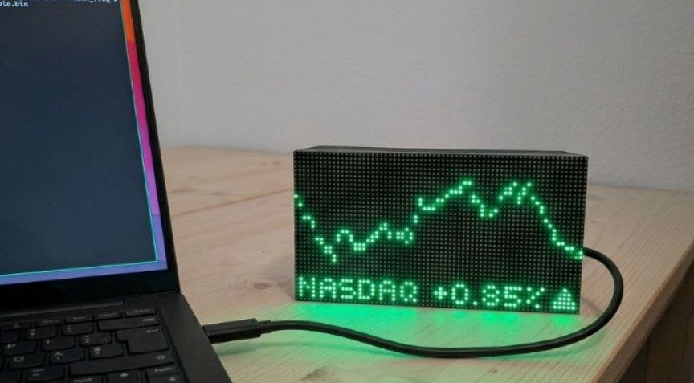

# 🌟 ESP32 HUB75 LED Matrix Dashboard



> Un progetto firmware basato su **ESP-IDF** per gestire una matrice LED HUB75, ideale per visualizzare l'orario in tempo reale, i prezzi di mercato finanziari e piccoli grafici di andamento, configurabile comodamente tramite un server web integrato.

---

## 🚀 Caratteristiche Principali

* **🕒 Orologio in Tempo Reale:** Sincronizzazione automatica dell'orario tramite NTP con gestione dei fusi orari.
* **📈 Prezzi di Mercato:** Monitoraggio di azioni o criptovalute in tempo reale.
* **📊 Grafici Minimali:** Visualizzazione di piccoli grafici di andamento direttamente sulla matrice LED.
* **🌐 Web Server Integrato:** Interfaccia grafica locale (HTML/JS) per configurare il Wi-Fi e le impostazioni del display senza ricompilare il codice.
* **🔌 Architettura a Componenti (ESP-IDF):** Codice modulare e pulito suddiviso in componenti riutilizzabili (`wifi`, `web_server`, `matrix`).

---

## 📂 Struttura del Progetto

Il progetto segue le best practice di ESP-IDF suddividendo le funzionalità in componenti dedicati nella cartella `components/`:

```text
esp_matrix_project/
├── CMakeLists.txt              # CMake principale di progetto
├── main/
│   ├── CMakeLists.txt
│   └── main.c                  # Entry point del firmware (app_main)
└── components/
    ├── web_server/             # Gestione delle richieste HTTP e pagine web
    │   ├── CMakeLists.txt
    │   ├── esp_server.c / .h
    │   └── html_page.h
    ├── wifi/                   # Connessione Wi-Fi e provisioning
    │   ├── CMakeLists.txt
    │   └── wifi_manager.c / .h
    └── matrix/                 # Gestione della matrice LED HUB75 e grafica
        ├── CMakeLists.txt
        ├── matrix.cpp
        ├── hub75_wrapper.cpp / .h
        └── fontmatrix.h
```

---

## 🛠️ Requisiti Hardware

* **Microcontrollore:** ESP32 / ESP32-S3 (consigliato per avere più memoria e risorse).
* **Display:** Matrice LED RGB HUB75 (es. 64x32 o 64x64).
* **Alimentazione:** Alimentatore esterno a 5V adeguato ad alimentare la matrice LED (le porte USB del PC non forniscono abbastanza corrente).

---

## ⚙️ Configurazione e Compilazione

Assicurati di aver installato e configurato correttamente l'ambiente **ESP-IDF** sul tuo PC.

1. **Clona il repository:**
   ```bash
   git clone https://github.com/tuo-username/tradermatrix.git
   cd tradermatrix
   ```

2. **Configura il progetto (opzionale):**
   ```bash
   idf.py menuconfig
   ```

3. **Compila e carica sul microcontrollore:**
   ```bash
   idf.py -p PORTA_COM flash monitor
   ```
   *(Sostituisci `PORTA_COM` con la porta a cui è collegato l'ESP32, es. `COM3` su Windows o `/dev/ttyUSB0` su Linux)*

---

## 📱 Interfaccia Web

Una volta avviato il dispositivo e connesso alla rete Wi-Fi, potrai accedere all'interfaccia di controllo digitando l'indirizzo IP dell'ESP32 nel browser per:
* Inserire le credenziali Wi-Fi.
* Selezionare i ticker di mercato da monitorare.
* Modificare le modalità di visualizzazione sulla matrice LED.

---

## 🤝 Contribuire
I contributi sono benvenuti! Se vuoi suggerire miglioramenti o aggiungere nuove funzionalità, sentiti libero di aprire una *Pull Request* o un *Issue*.

## 🙏 Ringraziamenti e Crediti
Un ringraziamento speciale ai creatori delle librerie esterne utilizzate in questo progetto:
* [ESP32-HUB75-MatrixPanel-DMA](https://github.com/mrcodetastic/ESP32-HUB75-MatrixPanel-DMA) per la gestione ottimizzata della matrice LED HUB75 via DMA.
* [TetrisAnimation](https://github.com/...) per le animazioni.
